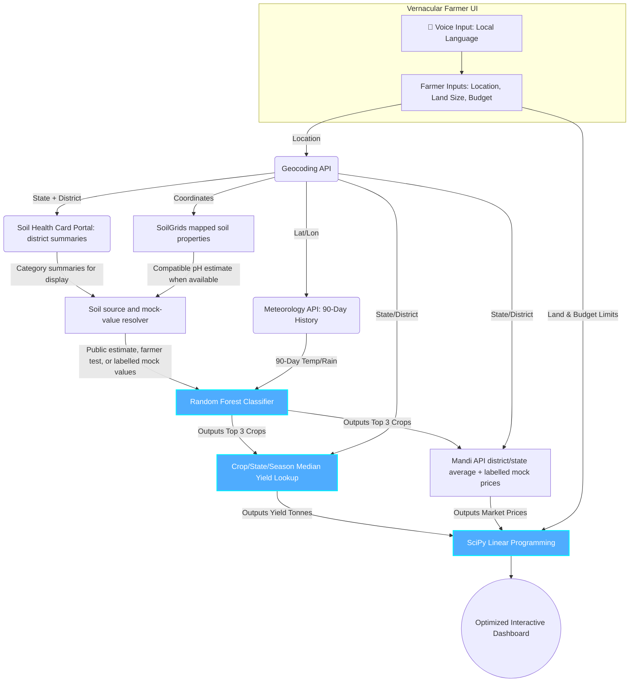

# AG_07_The_King
## VJH 2k26 Hackathon: AI-Based Crop and Agricultural Resource Optimization System

---

## Team Name & Details
* **Team ID:** AG_07
* **Team Name:** The_King
* **Team Leader Name:** Pavan Kumar
* **Team Leader Mobile Number:** 9849820952
* **Team Leader Email:** iec2025049@iiita.ac.in
* **College Name:** IIIT Allahabad

---

## Domain and Problem Statement
* **Domain:** Agritech & Rural Economics
* **The Problem (The Reality of Indian Farming):** 
  * **Data is Highly Scattered:** Currently, soil data, weather forecasts, and market prices are scattered across different government portals. There is no single centralized platform for a farmer.
  * **Lack of Optimization Platforms:** While generic weather apps exist, there are zero dedicated websites that mathematically optimize a farmer's budget and land allocation.
  * **The Usability Barrier:** Whatever few agricultural AI models exist are built for engineers. They expect farmers to manually input complex metrics like "Soil Nitrogen Ratio" or "pH value," which illiterate or rural farmers cannot understand.
* **Our Goal:** To build a unified, single-stop website driven by ML and Optimization Algorithms that strictly relies on **Farmer-Friendly Inputs**.

---

## Idea / Solution
* **The Core Idea:** A Unified, End-to-End Agri-Financial Web Platform.
* **How it Solves the Problem:**
  * **1. Centralized Intelligence:** We bring Soil Data, Weather Data, Crop Yield Predictions, and Market Prices into one single dashboard.
  * **2. Farmer-Friendly Inputs:** The farmer provides their Village Name, Total Land, and Budget. The app uses compatible public SoilGrids pH estimates when available and clearly labelled location-based static mock values for classifier features that are missing or incompatible. Farmer soil-test readings can override those sources.
  * **3. Actionable Output:** Instead of just saying "Grow Rice," the website acts as a financial advisor, calculating the mathematically perfect acreage split to maximize profit while keeping within the farmer's budget limits.

---

## Existing Vs Proposed System
* **Existing Systems:**
  * Disconnected apps (one for weather, one for mandi prices).
  * Inputs are highly technical and not user-friendly.
  * Outputs are generic (Classification only) and lack economic budgeting.
* **Our Proposed System:**
  * **Unified Ecosystem:** Weather, available Soil Health Card summaries, SoilGrids estimates, and market prices are retrieved automatically; missing soil fields use visibly labelled mock values for the prototype.
  * **Operations Research + ML:** We don't just predict; we optimize using Linear Programming.
  * **Vernacular UI:** Voice-first inputs in local languages making it accessible to rural India.

---

## Innovation & USP (Unique Selling Proposition)
*(Our innovations span across Models, Data, UX, and Economics)*

* **🤖 Advanced ML & Optimization Engine**
  * Seamlessly chaining *Random Forest* (for crop suitability) with a *crop/state/season hierarchical median yield lookup* and *SciPy Linear Programming* (for budget/land optimization).
* **🎙️ Zero-Friction Farmer UX**
  * Integrated Web Speech API for voice inputs in local languages. Public model estimates, farmer-provided measurements, and static mock fallbacks are identified separately.
* **📊 Intelligent Data Integration & APIs**
  * **Data Cleaning:** Custom NLP mapping to condense 124 scattered Indian crop names into 22 highly accurate AI target classes.
  * **Historical Weather:** We use a 90-Day Historical Archive API instead of generic daily weather.
  * **Soil Inputs:** The Soil Health Card portal provides district/block nutrient-category counts. SoilGrids provides mapped pH predictions when available; its total-nitrogen units do not match the classifier's N feature, and it does not provide the classifier's P/K features. Missing compatible features use location-keyed static mock values, clearly labelled in the UI; any plan using them is marked simulated.
  * **Scalability:** The soil source resolver keeps source provenance separate from classifier inputs. Prototype mock entries can be replaced by a validated, credentialed provider once access is available and its coverage, units, and feature definitions are verified; an API key alone does not make incompatible values comparable.
  * **Market Prices:** The public Mandi API provides market-level prices for Maharashtra, Karnataka, Uttar Pradesh, Madhya Pradesh, and Punjab. The prototype averages the latest reports for the resolved district, falls back to the API's state-average history, then uses clearly labelled mock prices if no quote is available. Quotes older than 14 days are identified as stale; plans with mock or stale prices are marked simulated.
* **📐 Indian Agricultural Unit Conversions**
  * Algorithms natively handle the conversion of government data (Hectares/Tonnes) into farmer-understandable Indian metrics (**Acres and Quintals**), ensuring the optimization math never crashes.

---

## Objective & Scope of Solution
* **Key Objectives:**
  * To bridge the digital divide by building an AI platform that uneducated farmers can use via Voice and simple Visual Dashboards.
  * To maximize farmer household profit while preventing the over-utilization of water and fertilizer budgets.
* **Scope:**
  * Specifically calibrated for the 22 most highly cultivated crops in India.
  * Live Mandi API coverage is available for Maharashtra, Karnataka, Uttar Pradesh, Madhya Pradesh, and Punjab; individual crop/state quotes can be missing, in which case the UI labels prototype mock prices.
  * Displays public Soil Health Card category summaries when available; uses compatible SoilGrids pH estimates and clearly labelled static mock values for unavailable or incompatible classifier inputs.

---

## System Architecture (Logical Data Flow)
*(Note: Use this Mermaid flowchart to show exactly how data routes through the different models).*

---

## Detailed Resources Required
* **Machine Learning & Math:**
  * Scikit-Learn (Random Forest), hierarchical median yield lookup, SciPy (Linear Programming).
* **Data Sources (Kaggle):**
  * *Crop Recommendation Dataset* (Soil/Weather profiling).
  * *India Agriculture Crop Production* (Historical Yield analytics).
* **Live APIs & Mapping:**
  * **Open-Meteo:** For Geocoding and 90-Day Historical Climate Data.
  * **Public Mandi API:** `https://mandi-api.onrender.com/v1/prices` provides market reports and `https://mandi-api.onrender.com/v1/prices/history` provides state-average history for Maharashtra, Karnataka, Uttar Pradesh, Madhya Pradesh, and Punjab. The prototype aggregates latest reports in the geocoded district when available, then uses the API state average; unavailable crop/state quotes use labelled prototype mock prices. Data older than 14 days is marked stale, and any plan using mock or stale market prices is marked simulated.
* **Full-Stack Technologies:**
  * **Backend:** Python & FastAPI (for lightning-fast model inference).
  * **Frontend:** React + Vite + Vanilla CSS (for Glassmorphism & Voice API integration).

---

## True Impact & Working Prototype
* **🌍 True Impact:**
  * We are turning complex agronomy and mathematical economics into an accessible tool. By centralizing scattered data and providing an intuitive UI, we empower smallholder farmers to escape debt cycles, make data-driven planting decisions, and maximize their land's financial potential without needing technical literacy.
  
* **💻 Working Prototype:**
  * **Link:** `https://crops-henna.vercel.app/`
  * **Description:** The React frontend accepts location, land, and budget. The FastAPI backend resolves the district, displays Soil Health Card category summaries when available, uses compatible SoilGrids pH estimates and clearly labelled static mock values for unavailable or incompatible classifier features, then combines historical weather, the trained classifier, state/season yield medians, district/state Mandi API prices, and prototype mock prices in the optimizer. Plans that use mock soil, mock prices, or stale prices are explicitly marked simulated.
  * **Local API:** Set `VITE_API_URL=http://127.0.0.1:8000` before `npm run dev` to route the local frontend to the local FastAPI backend. Deployment should set `VITE_API_URL` to the deployed backend URL.
