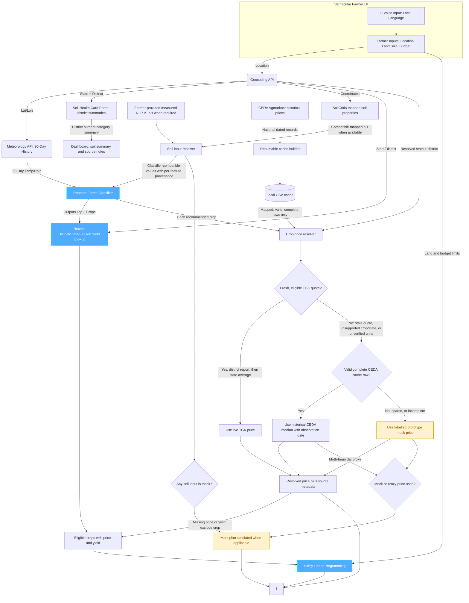

# AG_07_The_King
## VJH 2k26 Hackathon: AI-Based Crop and Agricultural Resource Optimization System

---

## Team Name & Details
* **Team ID:** AG_07
* **Team Name:** The_King
* **Team Leader Name:** Pavan Kumar
* **Team Leader Mobile Number:** 9849820952
* **Team Leader Email:** iec2025049@iiita.ac.in
* **College Name:** IIIT Allahabad

---

## Domain and Problem Statement
* **Domain:** Agritech & Rural Economics
* **The Problem (The Reality of Indian Farming):** 
  * **Data is Highly Scattered:** Currently, soil data, weather forecasts, and market prices are scattered across different government portals. There is no single centralized platform for a farmer.
  * **Lack of Optimization Platforms:** While generic weather apps exist, there are zero dedicated websites that mathematically optimize a farmer's budget and land allocation.
  * **The Usability Barrier:** Whatever few agricultural AI models exist are built for engineers. They expect farmers to manually input complex metrics like "Soil Nitrogen Ratio" or "pH value," which illiterate or rural farmers cannot understand.
* **Our Goal:** To build a unified, single-stop website driven by ML and Optimization Algorithms that strictly relies on **Farmer-Friendly Inputs**.

---

## Idea / Solution
* **The Core Idea:** A Unified, End-to-End Agri-Financial Web Platform.
* **How it Solves the Problem:**
  * **1. Centralized Intelligence:** We bring Soil Data, Weather Data, Crop Yield Predictions, and Market Prices into one single dashboard.
  * **2. Farmer-Friendly Inputs:** The farmer provides their Village Name, Total Land, and Budget. The app uses compatible public SoilGrids pH estimates when available and clearly labelled location-based static mock values for classifier features that are missing or incompatible. Farmer soil-test readings can override those sources.
  * **3. Actionable Output:** Instead of just saying "Grow Rice," the website acts as a financial advisor, calculating the mathematically perfect acreage split to maximize profit while keeping within the farmer's budget limits.

---

## Existing Vs Proposed System
* **Existing Systems:**
  * Disconnected apps (one for weather, one for mandi prices).
  * Inputs are highly technical and not user-friendly.
  * Outputs are generic (Classification only) and lack economic budgeting.
* **Our Proposed System:**
  * **Unified Ecosystem:** Weather, available Soil Health Card summaries, SoilGrids estimates, and market prices are retrieved automatically; missing soil fields use visibly labelled mock values for the prototype.
  * **Operations Research + ML:** We don't just predict; we optimize using Linear Programming.
  * **Vernacular UI:** Voice-first inputs in local languages making it accessible to rural India.

---

## Innovation & USP (Unique Selling Proposition)
*(Our innovations span across Models, Data, UX, and Economics)*

* **🤖 Advanced ML & Optimization Engine**
  * Seamlessly chaining *Random Forest* (for crop suitability) with a *recent district/crop/season historical-yield estimator* and *SciPy Linear Programming* (for budget/land optimization).
* **🎙️ Zero-Friction Farmer UX**
  * Integrated Web Speech API for voice inputs in local languages. Public model estimates, farmer-provided measurements, and static mock fallbacks are identified separately.
* **📊 Intelligent Data Integration & APIs**
  * **Data Cleaning:** Custom NLP mapping to condense 124 scattered Indian crop names into 22 highly accurate AI target classes.
  * **Historical Weather:** We use a 90-Day Historical Archive API instead of generic daily weather.
  * **Soil Inputs:** The Soil Health Card portal provides district/block nutrient-category counts. SoilGrids provides mapped pH predictions when available; its total-nitrogen units do not match the classifier's N feature, and it does not provide the classifier's P/K features. Missing compatible features use location-keyed static mock values, clearly labelled in the UI; any plan using them is marked simulated.
  * **Scalability:** The soil source resolver keeps source provenance separate from classifier inputs. Prototype mock entries can be replaced by a validated, credentialed provider once access is available and its coverage, units, and feature definitions are verified; an API key alone does not make incompatible values comparable.
  * **Market Prices:** The resolver prefers a fresh TGK market quote only for crops whose commodity and Rs/quintal units have been verified. No TGK crop is currently enabled because the feed does not document its price units. It then uses a complete national historical Agmarknet price cached through CEDA, followed by a clearly labelled mock price. CEDA rows are historical, not current quotes; sparse or incomplete rows are not used. Plans with mock or proxy prices are marked simulated.
* **📐 Indian Agricultural Unit Conversions**
  * Algorithms natively handle the conversion of government data (Hectares/Tonnes) into farmer-understandable Indian metrics (**Acres and Quintals**), ensuring the optimization math never crashes.

---

## Objective & Scope of Solution
* **Key Objectives:**
  * To bridge the digital divide by building an AI platform that uneducated farmers can use via Voice and simple Visual Dashboards.
  * To maximize farmer household profit while preventing the over-utilization of water and fertilizer budgets.
* **Scope:**
  * Specifically calibrated for the 22 most highly cultivated crops in India.
  * The TGK feed covers Maharashtra, Karnataka, Uttar Pradesh, Madhya Pradesh, and Punjab, but no crop is currently enabled until its price unit is documented. National CEDA historical prices are used when the local cache contains a complete row; otherwise the UI labels a prototype mock price.
  * Displays public Soil Health Card category summaries when available; uses compatible SoilGrids pH estimates and clearly labelled static mock values for unavailable or incompatible classifier inputs.

---

## System Architecture (Logical Data Flow)
*(Note: Use this Mermaid flowchart to show exactly how data routes through the different models).*



### Recommendation and plan explanations

The optimize response includes `classifier_reasoning`, `optimizer_reasoning`, and `ai_reasoning` for the results page:

* The classifier explanation shows each positively scored recommended crop's Random Forest ranking score and SHAP feature values. It returns up to three crops and omits zero-score classes, which are not meaningful recommendations. Scores are not calibrated odds of success, and SHAP values describe model attribution, not causation.
* The optimizer explanation shows yield and price conversions, estimated revenue/cost/net profit per acre, crop allocations, and land/budget/diversification limits. The linear program maximizes estimated net profit only across recommended crops with usable yield and price data. If the solver falls back to a proportional split, the response labels it as a fallback rather than an optimum.
* When `GEMINI_API_KEY` is configured, the backend sends classifier SHAP evidence, numerical farm inputs, crop economics, optimizer constraints, and allocations to Gemini (`gemini-3.1-flash-lite` by default) for a short explanation. The exact location and API key are not sent in the prompt. Gemini explanations are labelled AI-generated and may be wrong; the deterministic model and optimizer evidence remains available if no key is configured or the provider fails.
* Set `GEMINI_API_KEY` in the ignored local `.env` file. `GEMINI_MODEL` can override the default. Never commit `.env` or share the key in chat.

---

## Detailed Resources Required
* **Machine Learning & Math:**
  * Scikit-Learn (Random Forest), time-validated district-aware historical yield estimator, SciPy (Linear Programming).
* **Data Sources (Kaggle):**
  * *Crop Recommendation Dataset* (Soil/Weather profiling).
  * *India Agriculture Crop Production* (Historical Yield analytics).
* **Live APIs & Mapping:**
  * **Open-Meteo:** For Geocoding and 90-Day Historical Climate Data.
  * **TGK Mandi API:** `https://mandi-api.onrender.com/v1/prices` and `/v1/prices/history` provide market and state-average reports for Maharashtra, Karnataka, Uttar Pradesh, Madhya Pradesh, and Punjab. The resolver can use fresh district/state quotes only for explicitly verified crop names and units. The response does not document its price unit, so no TGK crops are currently enabled.
  * **CEDA / Agmarknet:** A local cache can hold national historical modal prices for mapped crops. Its latest verified date is 2025-10-30; these values are clearly labelled historical and must not be described as current market prices. Sparse or incomplete cache rows fall through to labelled prototype mock prices. `python scripts/build_ceda_cache.py --dry-run` previews the cache build without network access; running without `--dry-run` requires `CEDA_API_KEY` in the root `.env` and fetches data.
* **Full-Stack Technologies:**
  * **Backend:** Python & FastAPI (for lightning-fast model inference).
  * **Frontend:** React + Vite + Vanilla CSS (for Glassmorphism & Voice API integration).

---

## True Impact & Working Prototype
* **🌍 True Impact:**
  * We are turning complex agronomy and mathematical economics into an accessible tool. By centralizing scattered data and providing an intuitive UI, we empower smallholder farmers to escape debt cycles, make data-driven planting decisions, and maximize their land's financial potential without needing technical literacy.
  
* **💻 Working Prototype:**
  * **Link:** `https://crops-henna.vercel.app/`
  * **Description:** The React frontend accepts location, land, and budget. The FastAPI backend resolves the district, displays Soil Health Card category summaries when available, uses compatible SoilGrids pH estimates and clearly labelled static mock values for unavailable or incompatible classifier features, then combines historical weather, the trained classifier, recent district/state/season yield estimates, verified fresh TGK prices when available, cached historical CEDA prices, and prototype mock prices in the optimizer. Price sources and historical dates are shown; plans that use mock soil, mock prices, or proxy prices are explicitly marked simulated.
  * **Local API:** Set `VITE_API_URL=http://127.0.0.1:8000` before `npm run dev` to route the local frontend to the local FastAPI backend. Deployment should set `VITE_API_URL` to the deployed backend URL.

  ### Latency instrumentation and offline benchmark

  Set `TIMING=1` to add per-stage measurements to backend logs and the
  `Server-Timing` response header. The frontend also best-effort posts a location
  to `/api/prefetch` after the village field changes, warming geocoding, weather,
  and soil caches while the farmer completes the form. Prefetch failures do not
  block optimization.

  From the repository root, run the deterministic benchmark against recorded
  provider fixtures (no live API calls):

  ```powershell
  $env:TIMING = "1"
  .\.venv\Scripts\python.exe scripts\benchmark.py --requests 20 --compare-golden data\bench_golden.json --output data\bench_after.json
  ```

  The five unoptimized response fixtures are in `data/bench_golden.json`; the
  offline baseline measurements are in `data/bench_baseline.json`. Run backend
  and frontend checks with:

  ```powershell
  .\.venv\Scripts\python.exe -m pytest backend\tests -q
  Push-Location frontend
  npm test
  npm run lint
  npm run build
  Pop-Location
  ```

  ### Market price data notes

* `data/ceda_crop_map.final.json` contains the finalized mapping for the 22 classifier classes. Kidney beans has no verified CEDA commodity ID and always uses the labelled mock price; moth bean uses a processed-dal proxy and is marked simulated.
* `data/ceda_price_cache.csv` is an optional local artifact and is intentionally git-ignored. The application validates each row against its commodity mapping and uses only rows marked neither sparse nor incomplete. It labels accepted values with their observation month and source.
* To build the national cache, configure `CEDA_API_KEY` in `.env`, review the plan with `python scripts/build_ceda_cache.py --dry-run`, then run `python scripts/build_ceda_cache.py` when ready. The builder records progress so interrupted runs can resume. Do not commit `.env`, cache progress, or the generated cache.
